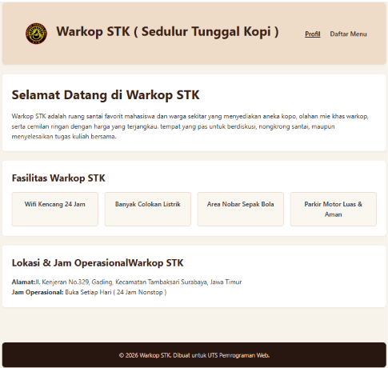
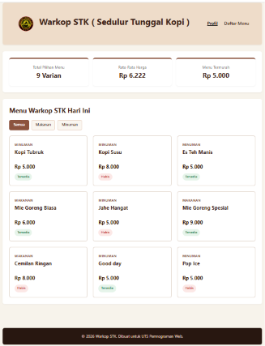

# UTS Pemrograman Web - Profil & Katalog Warkop STK

## 1. Identitas mahasiswa
*   **Nama: [Mochammad Pasha Ariya Bima]**
*   **NIM: [025aA0231003]**
*   **Kelas: [S1 Informatika]**

## 2. Deskripsi tema
Warkop STK adalah website profil dan katalog berbasis PHP native untuk usaha warung kopi lokal. Website ini menyajikan informasi profil, fasilitas warkop, serta katalog menu makanan dan minuman secara dinamis dengan ringkasan statistik stok dan harga otomatis.

## 3. Cara menjalankan di Localhost
berikut panduan langkah demi langkah untuk menjalankan website dikomputer ataupun laptop:

1.  **persiapan folder proyek:**
    *   pindahkan folder proyek ini ke dalam direktori web server lokal seperti **laragon** : letakkan di /laragon/www masukkan folder ini (uts-pemweb-025a00231003)
2.  **menjalankan diweb server:**
    *   buka aplikasi laragon klik "start" dikiri bawah lalu "klik "menu" pilih "www" lalu pilih folder "uts-pemweb-025a00231003", jika sudah akan muncul di chrome atau microsoft edge
3.  **navigasi antar halaman:**
    *   klik menu "profil" untuk membuka index.php dan menu "daftar menu" untuk membuka katalog.php

## 4.daftar fitur
berikut adalah fitur-fitur yang tersedia di website beserta file dan nama fungsi buatan sendiri yang menanganinya:
*   fitur keamanan teks:
    * berkas: functions.php
    * nama fungsi: e(string $nilai): string
    * penjelasan: mengamankan output teks sebelum dicetak ke tag HTML menggunakan htmlspecialchars dengan konfirmasi ENT_QUOTES
* fitur format mata uang rupiah:
    * Berkas: functions.php
    * Nama Fungsi: formatRupiah(int $angka): string
    * Penjelasan: Mengubah data nominal angka bulat (integer) menjadi format mata uang resmi Rupiah (Rp X.XXX).
* Fitur Status Ketersediaan & Warna Badge:
    * Berkas: functions.php
    * Nama Fungsi: getStatusBadge(int $stok): array
    * Penjelasan: Menerapkan percabangan match PHP untuk menentukan label ketersediaan ("Habis", "Sisa X porsi", "Tersedia") beserta kelas warna styling CSS secara dinamis.
* Fitur Ringkasan Statistik Menu:
    * Berkas: functions.php
    * Nama Fungsi: hitungRingkasan(array $data): array
    * penjelasan: Mengolah seluruh data array menu untuk menghitung total variasi menu, rata-rata harga, dan menu termurah pada kartu statistik.
* Fitur Penyaringan Kategori Menu (Semua, Makanan, Minuman):
    * Berkas: katalog.php
    * Penanganan: Ditangani oleh fungsi bawaan array_filter() yang dipadukan dengan parameter query URL $_GET 'kategori'.

## 5.Daftar Fungsi Array Bawaan
Proyek ini mengimplementasikan fungsi array bawaan (built-in) PHP untuk manipulasi data tanpa penulisan perulangan manual:
1. count()
    * Lokasi: functions.php (di dalam fungsi hitungRingkasan).
    * Kegunaan: Menghitung jumlah total item menu yang terdapat di dalam array multidimensi $daftarMenu.
2. array_column()
    * Lokasi: functions.php (di dalam fungsi hitungRingkasan).
    * Kegunaan: Mengambil dan mengekstrak seluruh nilai pada atribut/kolom 'harga' dari array multidimensi menjadi satu deret array satu dimensi.
3. array_sum()
    * Lokasi: functions.php (di dalam fungsi hitungRingkasan).
    * Kegunaan: Menjumlahkan akumulasi nilai nominal seluruh harga menu yang diperoleh dari array_column untuk dihitung nilai rata-ratanya.
4. array_filter()
    * Lokasi: katalog.php.
    * Kegunaan: Menyaring elemen-elemen array menu berdasarkan kategori yang dipilih pengguna via tombol filter di halaman katalog.
## 6.Tangkapan Layar
Berikut adalah pratinjau tampilan antarmuka website yang diambil dari folder screenshots/:
  * Tangkapan Layar 
  * Tangkapan Layar 
## 7. Catatan
* Bantuan AI : membantu untuk merapikan struktur kode dan css